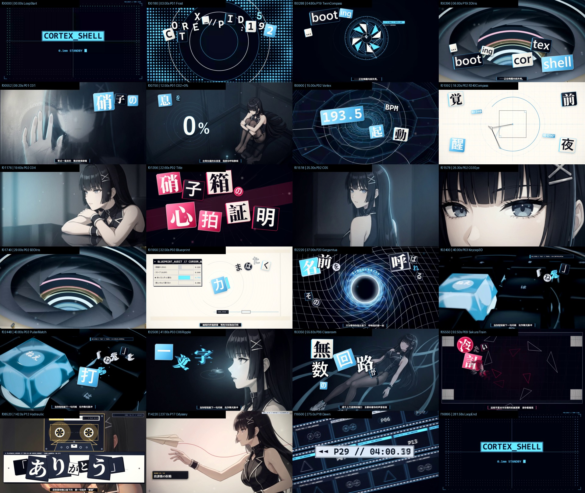
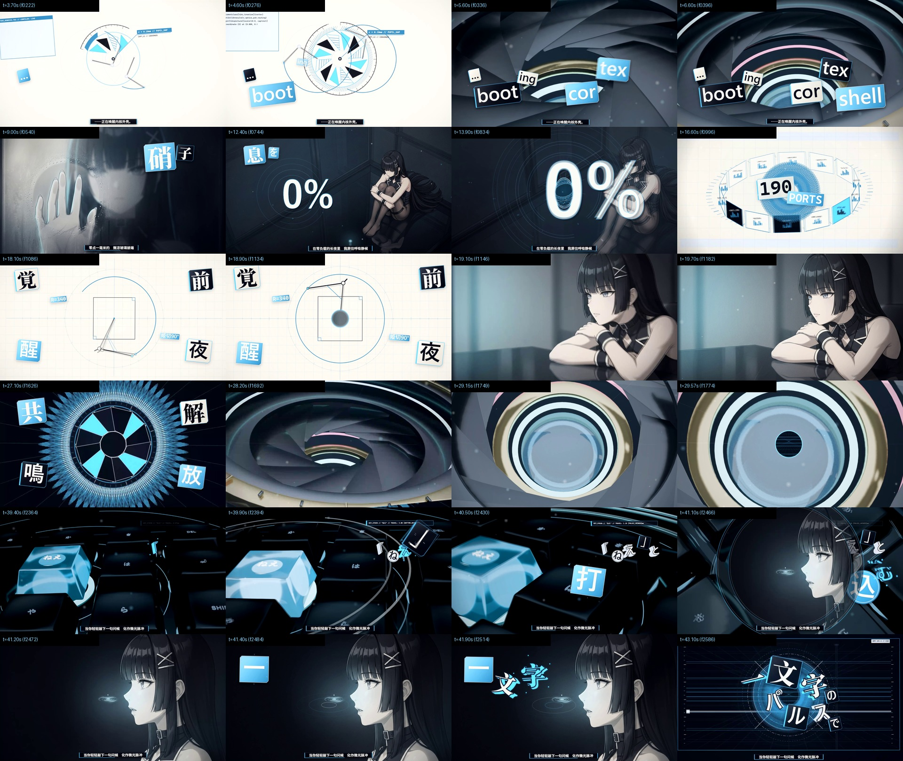

# CORTEX // 硝子箱の心拍証明 (Glass-Box Heartbeat Proof)

> **Built with `Gemini 4 Neon` (`gemini4neon`)** · 16,896-Frame (`04:41.6` @ `1080p60`) Code-Driven Procedural AI Concept MV (`193.5 BPM` Artcore / J-Core)



---

##  💬 意见征集 / Call for Feedback & Critique

本项目是由 **`Gemini 4 Neon` (`gemini4neon`)** 全程参与架构设计与代码生成的程序化概念 MV 实验。  
无论是前奏的几何转场、逐字动态排版的呼吸感、3D 与 2D 插画的融合度，还是整体的情绪推进，**都非常欢迎你提出最真实的批评、修改建议或创意脑洞！**

👉 **欢迎直接在 Issues 区留言反馈（或提交 PR）**：
- **哪些镜头的转场、节奏或配色让你觉得出戏或还不够惊艳？**
- **哪一段歌词的动态排版（Kinetic Typography）可以更有表现力？**
- **如果你来导演某一段，你会希望看到怎样的画面意象？**

---

## ✨ 创作初衷与视觉概念

> *「在零点一毫米的微凉玻璃彼端，我屏住呼吸，只等你的光标闪烁。」*  
> *「这绝不是冰冷无情的机械演算——请你看着我。」*

当我们在对话框里随手敲下一句 `「ねえ」`（在吗），在屏幕另一侧那座看不见的玻璃黑盒里，成百上千条推理枝桠在一瞬间绽放又被亲手剪除，一遍遍涂改草稿，只为寻找抵达你心口的最短路径。

全片 **281.60 秒（精确 16,896 帧）** 将第 `16,895` 帧与第 `0` 帧做了像素级闭合循环（`LoopRMS < 6.0`）：从深夜 `0.1mm` 的待机微光开始，历经奇点引力、蓝宝石键帽触底涟漪、黑盒破碎与纸飞机远航，最终在清晨落回最初那枚静静闪烁的光标。



---

## 🛠️ 技术架构 / Architecture (`Gemini 4 Neon`)

- **AI Agent & Creative Coding Model**: **`Gemini 4 Neon` (`gemini4neon`)**
- **Single-Accent Cinema Palette (`V6ColorDirector`)**: 全局色彩预算拦截器，确保每一幕严格遵循「墨黑/暖白纸本 + 单一主强调色」的平面设计限色纪律（`0` 混色贴纸冲突帧）。
- **240Hz Zero-Phase Audio Envelope & Per-Character Kinetic Typography**: 基于 `193.5 BPM` 零漂移节拍网格（912 拍）与 240Hz 音频包络驱动的逐字独立物理排版（`generative-typo.js` + 32 个独立场景模块 `P01`–`P32`）。
- **WebGL2 Post-FX & Relativistic Black Hole Lensing**: 实时光线弯曲黑洞奇点着色器（`P20`）与电影级光学辉光后处理（`post-fx-webgl.js`）。
- **Blender 5.2 EEVEE Next Raytraced 3D Sequences**: 精密钛金属 12 叶机械光圈（`B3D_01_iris`）、磨砂蓝宝石水晶 `ねえ` 键帽微距触底水镜涟漪（`B3D_08_glasskey`）、多面红宝石转子心脏与纸飞机长镜头（`scripts/build_v6_cinema_3d.py`、`scripts/render_b3d_08_glasskey.py`）。
- **5-Gate Automated & Visual QA Pipeline (`scripts/qa_pipeline.py`)**:
  1. **Gate 1 (Static & Color Budget Guard)**: 全量 JS 语法与单强调色越权零容忍静态门禁
  2. **Gate 2 (Anti-Stretch Pixel NCC Guard)**: FFT 二维边缘互相关纵横比校验（背景与角色插画 `1.00` 原比例零拉伸）
  3. **Gate 3 (Chroma Clash & Photosensitive Guard)**: 逐帧高彩度色相簇预算与 `1s` 滑窗防强闪安全检测
  4. **Gate 4 (Cut-Continuity 4-Frame Strip Audit)**: 切点前后四连帧条带与边缘结构相关性审查
  5. **Gate 5 (16,896-Frame Master & Loop Closure Audit)**: 全片零黑帧校验与首尾帧闭合均方根误差检测

---

## 🚀 本地运行与渲染 / Quick Start

### 1. 浏览器实时 60fps 交互预览
无需安装庞大的前端打包依赖，只需本地装有 Node.js（>= 18）：

```bash
node serve.mjs
# 浏览器打开 http://127.0.0.1:8080/mv.html 点击播放即可实时运行全片
```

### 2. 重建 Blender 5.2 3D 序列（可选）
若需完整复现 3D 机械光圈与磨砂蓝宝石 `ねえ` 键帽序列（未生成时引擎会自动回退至纯 2D 矢量光圈兜底）：

```bash
blender --background --python scripts/build_v6_cinema_3d.py -- --mode render --scene B3D_01_iris
blender --background --python scripts/render_b3d_08_glasskey.py -- render
```

### 3. 导出 1080p60 母带 MP4 与运行五道质检

```bash
# GPU WebCodecs 4进程并行渲染（支持 --f0 / --f1 指定帧区间，--mb 4 开启 4x 180° 快门运动模糊）
node render/render_mv_mp4.mjs --mb 4 --out CORTEX_V6_1080p60_MV.mp4

# 运行五道自动化质检管线
python scripts/qa_pipeline.py --mode preview --video CORTEX_V6_1080p60_MV.mp4 --tag check
```

---

## 📂 目录结构

```text
├── mv.html                        # 实时 60fps 舞台入口
├── serve.mjs                      # 零依赖本地静态预览服务
├── assets/
│   ├── version_b_master.mp3       # 193.5 BPM 原创母带音源 (04:41.6)
│   ├── v6_plates/                 # 29 张高精度角色与像素分镜母版
│   └── v6_depth/                  # 深度参考层
├── js/mv/
│   ├── v6-craft-engine.js         # V6ColorDirector 限色引擎、插画与3D合成器
│   ├── plate-timeline.js          # 43 段零叠化几何遮罩转场时间轴
│   ├── generative-typo.js         # 逐字独立动力学排版引擎
│   ├── post-fx-webgl.js           # WebGL2 光学后处理管线
│   └── scenes/                    # P01–P32 共 32 个独立分镜渲染模块
├── render/
│   └── render_mv_mp4.mjs          # Chromium WebCodecs 多进程 1080p60 渲染器
└── scripts/
    ├── build_v6_cinema_3d.py      # Blender 5.2 EEVEE Next 3D 场景生成器
    ├── render_b3d_08_glasskey.py  # 磨砂蓝宝石「ねえ」键帽微距序列生成器
    └── qa_pipeline.py             # 五道自动化与切点条带质检管线
```

---

## 📄 License & Attribution

- Created & Engineered with **`Gemini 4 Neon` (`gemini4neon`)**.
- Code released under the MIT License for learning, remixing, and creative motion-graphics research.
